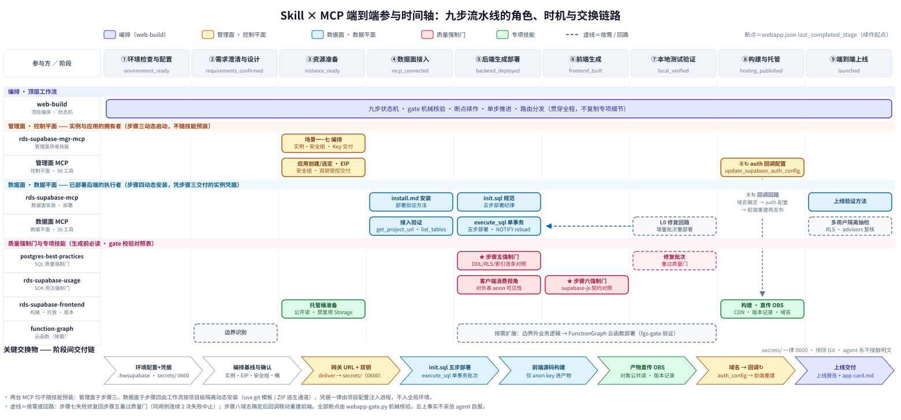

# 建站模式对比报告：传统自建 vs Supabase+OBS 全栈托管

> **演示材料（showcase）**：本文档用于展示与评估两种建站模式的差异，属测试/演示用途，**不参与技能运行**；技能的安装与使用以 [SKILL.md](SKILL.md) 与 [INSTALL.md](INSTALL.md) 为准。
>
> 面向读者：评估建站技术路线的决策者与开发者。本报告对比传统"前端→后端→数据库"自建链路，与本技能编排的全托管链路（RDS Supabase + OBS/CDN + FunctionGraph），说明各环节的职责转移、效率差与安全模型差异。

**一句话价值主张**：传统模式将工程精力消耗于系统运维（采购机器、搭建链路、维护服务）；全托管模式将建站收敛为**两个声明式产物——一份后端声明式配置与一次前端构建上传**，其余全部由托管层与机器核验承接。

---

## 1. 架构与流程对比（左右对照）

*左列：前端、后端两条链路各自完成开发、部署、运行的全流程自建；右列：同一链路收敛为声明式产出与托管服务，工具对接如下——rds-supabase Skill 套件全程编排：前端代码经 **supabase-js** 接入（usage 技能规范用法）；后端声明式配置（数据建模 · CRUD 接口 · Data-Function RPC · 权限 · 初始数据）生成经 **best-practices 质量门**，由 **rds-supabase-mcp** 经 execute_sql 单事务初始化；**Supabase 实例由 rds-supabase-mgr-mcp 动态创建**；OBS 桶建立与产物直传由 **rds-supabase-frontend 技能 + KooCLI** 执行；交付经 **gate 机器核验**。结论条直陈四项核心差异：开发周期、部署步骤、前端服务器数、后端实体数。*

---

## 2. 工作项映射：传统模式十项工作

| # | 传统模式工作项 | 全托管等价物 | 变化 |
|---|---|---|---|
| 1 | 后端应用开发（接口层/ORM/鉴权自研） | 声明式后端配置（init.sql）：数据建模（库表定义）· CRUD 接口自动生成 · Data-Function 库内存储过程 RPC · 权限配置（RLS）· 初始化数据——后端即数据层；复杂逻辑 → FunctionGraph | 开发量从"一个应用"降为"一份声明式配置" |
| 2 | CICD 流水线搭建与维护 | `execute_sql` 单事务五步部署；前端产物直传 OBS | **消除** |
| 3 | 微服务初步（拆分/注册中心/网关/追踪） | Postgres RPC（数据类逻辑）+ FunctionGraph（I/O 类逻辑）按需取用 | **消除**（v1 边界内） |
| 4 | ECS 购买/规格调优/OS 补丁/容量规划 | RDS Supabase 托管实例 | **云侧托管** |
| 5 | 网络配置（VPC/SLB/nginx/证书） | EIP + 安全组 8443 一次配置（管理面自动化），Kong 网关实例自带 | **自动化** |
| 6 | 后端部署与滚动发布 | init.sql 批次部署 + sha256 留痕（单命令） | 单命令化 |
| 7 | 前端 Node.js/nginx 部署 | OBS 静态托管 + CDN | **消除**（零服务器） |
| 8 | 鉴权体系自研（session/JWT/密码策略） | GoTrue：JWT 签发 + anon/service 双钥 + RLS | **内建** |
| 9 | 安全加固与自查 | RLS 声明式行级安全 + advisors 机器体检 + gate `--verify` 直连核验 | 内建 + 机器核验 |
| 10 | 扩容与峰值应对 | 托管服务弹性 + 函数天然弹性 | **云侧托管** |

---

## 3. 自行运维实体对比

| 需自行运维的实体 | 传统模式 | 全托管模式 |
|---|---|---|
| 服务器 / OS | ECS × 2+（前端托管 + 后端服务群）+ SLB | **0**（托管实例 + 对象存储） |
| 运行时（Node/JVM） | × N，随服务数增长 | **0** |
| CICD 流水线（Runner + 镜像仓库） | × 1 套，自建自养 | **0** |
| 反向代理（nginx） | × N | **0**（Kong 网关自带） |
| 鉴权服务 | × 1，自研自养 | **0**（GoTrue 内建） |

**说明**：右侧归零的每一行，均为传统模式中不产生业务价值的非差异化工作——采购、补丁、升级、证书轮换、容量预估——在新模式工程清单中全部消失。

---

## 4. 交付效率对比

| 维度 | 传统模式 | 全托管模式 |
|---|---|---|
| 触发方式 | 立项 → 架构评审 → 采购 → 搭建（人工编排） | **一句自然语言**（如"帮我建一个博客网站"） |
| 交付步骤 | 15+ 手工步骤（采购/初始化/搭建/部署/调优） | 8 个声明式步骤，断点续作 |
| 首站周期 | 数天~数周（受采购与搭建制约） | 小时级（实例创建 + 8 步流水线） |
| 过程感知 | 分散在各系统日志 | 进度看板全流程可视 + gate 逐断点核验 |
| 质量保障 | 依赖团队规范与评审 | best-practices 强制门 + SDK 契约门 + 机器验证 |

---

## 5. 安全模型对比

| 维度 | 传统模式 | 全托管模式 |
|---|---|---|
| 身份认证 | 自研（易出漏洞：密码策略/token 刷新/重置流程） | GoTrue 托管（JWT 签发/刷新/邮箱回路内建） |
| 前端持有凭据 | 视实现而定，常把高权凭据带进前端 | 分层设计：前端只持 anon 钥；service 钥**绝不进前端** |
| 行级数据隔离 | 应用层代码实现（逻辑分散、易漏） | RLS 声明式（数据层强制，策略即代码） |
| 安全自查 | 人工渗透测试与定期审计 | advisors 机器体检（性能/安全）持续扫描 |
| 上线验收 | 人工点检 | gate `--verify` **直连云核验**：对外表 anon 可见性、RLS 启用、advisors 零命中——不采信 agent 自报 |

---

## 6. 生命周期运维对比

| 操作 | 传统模式 | 全托管模式 |
|---|---|---|
| 后端更新 | 重新构建 → CICD → 滚动发布（停机窗口/灰度策略自管） | 新 init.sql 批次单事务部署，sha256 留痕可追溯 |
| 前端更新 | 重新构建 → 上传产物到 ECS → nginx 刷新 | 构建产物直传 OBS，重复发布快速路径（≤5 分钟量级） |
| 回滚 | 回滚镜像 + 数据库脚本（高风险，常需人工缝合） | init.sql 批次状态记录 / 前端版本三字段 + `rollback_verified`——**切换≠成功，重验收后才算** |
| 下线 | 多台 ECS/SLB/流水线/证书逐一清理（易残留） | `decommissioned` 单向清单（删触发器→删函数→清产物→删实例，两阶段确认） |
| 凭据轮换 | 自研轮换流程 | 项目级隔离存放（`.hwsupabase/secrets/`），轮换只影响本项目 |

---

## 7. 技能与 MCP 清单（参与方一览）

全托管链路由「**1 个顶层编排 + 6 个专项技能 + 双平面 MCP**」构成。两台 MCP **均不随技能预装**——由工作流在步骤三（管理面）与步骤四（数据面）按项目级隔离动态安装，凭据一律由项目配置（`.hwsupabase/`）注入进程。

### 双平面 MCP

| 平面 | 服务 | 工具数 | 职责 | 参与时机 |
|---|---|---|---|---|
| 管理面（控制平面） | `mcp_server_rds_supabase_mgr` | 53 | 实例创建/选定、EIP/安全组/SSL 配置、API Key **受控交付**（值只落受保护文件）、`update_supabase_auth_config` 回调配置、订单支付/取消、应用删除；两阶段确认 + 执行账本 | 步骤三动态启动；步骤八↻ 回调配置 |
| 数据面（数据平面） | `mcp_server_rds_supabase` | 38 | `execute_sql` 单一事务（init.sql 五步部署的执行者）、结构/RLS/advisors 查询、认证用户管理、TypeScript 类型生成、存储配置；只读拦截/审计脱敏 | 步骤四动态安装（凭步骤三交付的网关 URL + 双钥） |

### 技能（1 编排 + 6 专项）

| 技能 | 定位 | 参与时机 | 功能说明 |
|---|---|---|---|
| `rds-supabase-web-build` | 顶层编排 | 全程 | 九步状态机与断点续作（`last_completed_stage`）、gate 机械核验、单步推进纪律、路由分发——只编排不复制专项细节 |
| `rds-supabase-mgr-mcp` | 管理面技能 | 步骤三 | 实例全生命周期场景编排（创建编排/资源准备/Key 交付纪律/订单/删除）；步骤三显式遵循其场景一~七，本技能不复述不改写 |
| `rds-supabase-mcp` | 数据面技能 | 步骤四起 | 数据面 MCP 安装指南（`references/install.md`）、init.sql 编写规范与五步部署、部署验证方法、单工具数据操作 |
| `rds-supabase-postgres-best-practices` | SQL 质量门 | **步骤五强制门** | DDL/列类型/RLS/索引/触发器/函数/主键选型规则库——init.sql 生成前逐条对照，gate 校验对照表；修复批次同样重过 |
| `rds-supabase-usage` | SDK 用法门 | **步骤五/六** | supabase-js / @supabase/ssr 正确用法、auth 流、RLS 客户端消费视角、REST 行为与报错速查——前端生成前必读 |
| `rds-supabase-frontend` | 前端专项 | 步骤三 / 八 | 构建环境、OBS 静态托管（对象级公共读）+ CDN、版本记录与回退、入口域名（临时访问/正式上线两场景） |
| `rds-supabase-function-graph` | 云函数扩展（按需） | 边界识别后 | v1 后端边界外的业务逻辑（出站 HTTP/第三方对接/定时作业）→ FunctionGraph 云函数，经 KooCLI 编排 + fgs-gate 验证 |

---

## 8. 端到端参与时间轴：谁在哪一步、交付什么

*九列＝九步流水线（下挂各步断点标记）；九行＝参与方（按编排/管理面/数据面/质量门分组泳道）；实心条＝主线必经，虚线＝按需或回路；底部雪佛龙链＝阶段间关键交换物。*

### 步骤 × 参与方 × 交付物

| 步骤（断点） | 技能参与 | MCP 参与 | 交付物（出） |
|---|---|---|---|
| ①环境检查与配置（environment_ready） | web-build | —（接入点缺失时经管理面 discover 解析） | 项目配置 + `secrets/`（0600、排除 Git） |
| ②需求澄清与设计（requirements_confirmed） | web-build、function-graph（边界识别） | — | 需求摘要 · BaaS 能力清单 · 设计指标 · 费用预估 |
| ③资源准备（instance_ready） | mgr-mcp（场景编排）、frontend（托管桶） | **管理面 MCP 动态启动**：应用创建/选定 · EIP · 安全组 · 双钥交付 | 网关 URL + 双钥（deliver → secrets/）· 桶就绪 |
| ④数据面接入（mcp_connected） | rds-supabase-mcp（安装指南） | **数据面 MCP 动态安装**：get_project_url == 网关 · list_tables | 数据面连通（SUPABASE_URL/双钥注入） |
| ⑤后端生成部署（backend_deployed） | **best-practices 强制门**、usage（消费视角）、rds-supabase-mcp（五步部署） | 数据面：execute_sql 单事务 → NOTIFY reload → advisors/REST 复核 | init.sql + teardown.sql 批次（sha256 留痕） |
| ⑥前端生成（frontend_built） | **usage 强制门** | — | 源码 + 构建产物（仅 anon key 进产物） |
| ⑦本地测试验证（local_verified） | web-build（L0 用例孵化） | 数据面（修复回路：增量批次重部署） | L0 测试报告（≥5 passed、零 failed） |
| ⑧构建与托管（hosting_published） | frontend（构建/直传/域名） | 管理面（↻ 回调配置） | 产物直传 OBS（公共读）+ 版本记录 + 入口域名 |
| ⑨端到端上线（launched） | web-build | gate `--verify` **直连云核验**（REST 可达/anon 可见性/RLS/advisors） | 上线报告 + `app-card.md` |

### 三次关键交接

1. **凭据交接（③→④）**：管理面 `deliver_supabase_api_key` 把网关 URL + Anon/Service Role 双钥写入 `.hwsupabase/secrets/`（0600、排除 Git）——这是数据面 MCP 安装的唯一必需输入；webapp.json 只记 env 名，**agent 永不接触明文**。
2. **后端即数据层（⑤）**：需求 → init.sql（DDL/GRANT/RLS/RPC/种子 + teardown.sql）→ best-practices 强制门 → `execute_sql` 单事务五步部署（预检 → 审查 → 执行 → NOTIFY `pgrst, 'reload schema'` → 确认）→ gate `--verify` 直连云核验——**后端不存在应用代码，部署物就是一份声明式 SQL**。
3. **回调闭环（⑧↻）**：入口域名确定 → 管理面 `update_supabase_auth_config` 配 site_url/redirect_uris → 前端按最终地址**重建再发布**——auth 登录链路与实际入口始终一致，这是唯一的跨平面回路。

### 两条回路

- **修复回路（⑦→⑤）**：L0 失败的后端缺陷 → 增量 init.sql 批次 → 重过 best-practices 质量门 → 重新部署；同用例连续 2 次失败即中止报告，不无限循环。
- **生命周期（launched 之后）**：更新＝增量批次重走⑤⑧⑨；回滚＝前端版本回退（frontend 契约）+ 后端向前修复；下线＝teardown.sql 一键清理 + 管理面删除 + 项目级注册回收；密钥轮换＝管理面重置 → 数据面 env 同步 → 前端重建再发布。

---

## 9. 边界与适用性（诚实声明）

- **v1 后端边界为数据层**：纯数据变换/事务内一致性用 Postgres RPC；出站 HTTP、外部系统对接、交易通知、高安全隐私处理由 FunctionGraph 承载（`rds-supabase-function-graph` 技能）。
- **不支持 SSR / 长驻进程 / WebSocket 服务端**：前端为静态导出形态（继承 frontend 技能边界）。
- **极端定制化场景**（特殊运行时、私有协议、强依赖既有微服务资产）传统模式仍有其位置——本报告对比的是"从零建站并长期运维"这一主流场景下两者的总成本与风险面。

---

## 结论

传统模式的复杂度是**刚性且持续**的：链路上每一个自建组件均为长期负债（升级、补丁、故障面）。全托管模式的复杂度是**一次性且声明式**的：两个产物（后端声明式配置与前端构建产物）声明"目标状态"，托管层负责持续运行，gate 负责机器验证"确实达成"。建站成本由"运维一套完整系统"转变为"维护一份声明式配置"。
